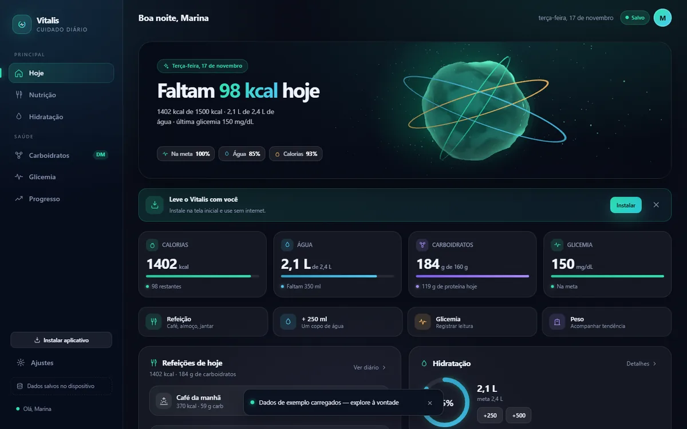
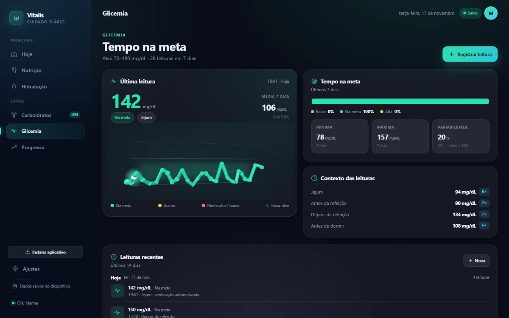
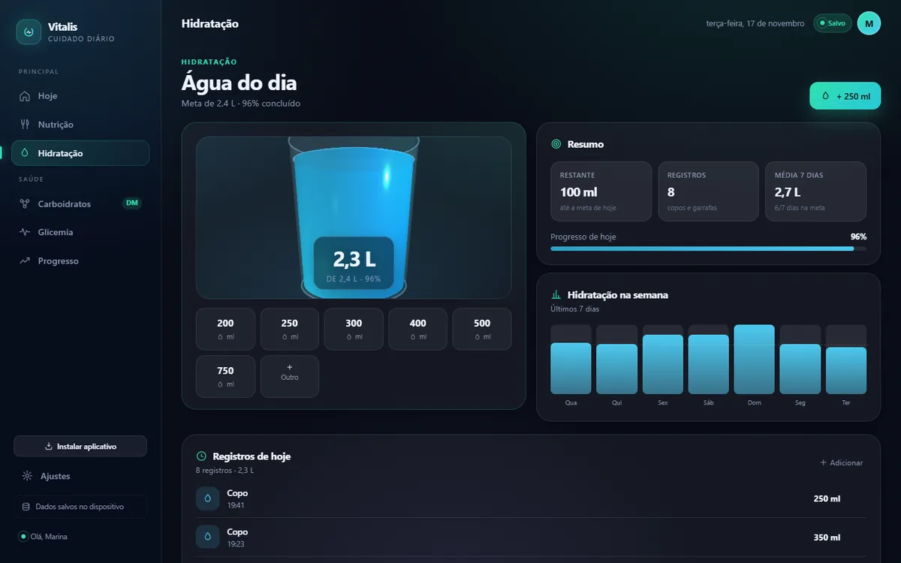
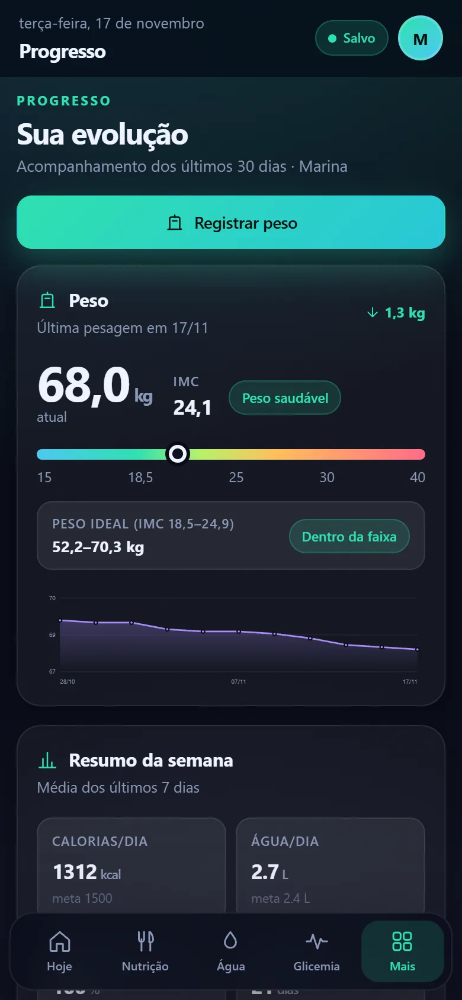

# Vitalis

PWA de cuidado diário para acompanhar **calorias, hidratação, carboidratos e glicemia** — com animações em three.js, banco local (IndexedDB) e funcionamento **100% offline**. Nenhum dado sai do dispositivo: não existe conta, servidor ou rastreamento.



| Glicemia | Hidratação | Progresso no celular |
| --- | --- | --- |
|  |  |  |

> **Demo online:** depois do deploy, o app fica disponível em GitHub Pages com HTTPS — necessário para instalar no Android e funcionar offline.

## O que o app faz

| Área | Recursos |
| --- | --- |
| **Hoje** | Resumo do dia com orbe 3D reativo, metas, atalhos de registro e linha do tempo |
| **Nutrição** | Diário por refeição, base com 100+ alimentos brasileiros, porções, macros, fibras, gráfico semanal e alimentos personalizados |
| **Hidratação** | Copo 3D com nível animado, atalhos (200–750 ml), volume personalizado, média de 7 dias e histórico |
| **Carboidratos** | Total por refeição, estimativa de bolus por refeição e calculadora com relação carbo/insulina e fator de sensibilidade |
| **Glicemia** | Curva 3D das leituras, tempo na meta, GMI, variabilidade (CV), médias por contexto e histórico |
| **Progresso** | Peso e IMC com escala visual, **faixa de peso ideal (IMC 18,5–24,9)** e distância até ela, tendência de 30 dias, resumo semanal, sequência e conquistas |
| **Ajustes** | Perfil, metas automáticas ou manuais, parâmetros clínicos, tema claro/escuro, backup/importação, CSV e dados de demonstração |

### Metas calculadas

- **Gasto energético:** Mifflin-St Jeor + fator de atividade, com déficit/superávit conforme o objetivo.
- **Macros:** proteína por kg, gordura e carboidratos distribuídos sobre a meta calórica (todos ajustáveis).
- **Água:** 35 ml por kg, com limites de segurança.
- **Glicemia:** tempo na meta, GMI (3,31 + 0,02392 × média) e coeficiente de variação.
- **Bolus:** `(carboidratos ÷ ICR) + (glicemia atual − alvo) ÷ ISF − insulina ativa`, arredondado a 0,5 U.

> ⚕️ **Aviso:** o Vitalis é educativo e organiza registros. Não diagnostica, não prescreve e não substitui acompanhamento médico ou nutricional. Metas e doses devem ser definidas pela sua equipe de saúde.

## Stack

- **React 19 + TypeScript + Vite 7** — interface e build, com layout **mobile-first** (áreas de toque ≥ 38 px, sheets em tela cheia, safe areas de iPhone e tipografia adaptativa).
- **three.js** — quatro cenas: orbe do dashboard, copo d'água com clipping e ondas, fita 3D de glicemia com pulso luminoso percorrendo a curva e molécula de carboidratos. Renderer com pausa fora da tela, limite de DPR, descarte completo e respeito a `prefers-reduced-motion`.
- **IndexedDB** — stores `profile`, `logs` (índices por data e tipo), `foods` e `meta`; fallback em memória quando o navegador bloqueia o banco.
- **Service worker próprio** — precache versionado por hash de conteúdo, navegação network-first com fallback offline, cache-first para assets e fluxo de atualização com aviso.
- **Sem dependências de UI, gráficos ou estado** — CSS, SVG e hooks próprios.

## Rodando

Requisitos: Node 20.19+ (ou 22.12+) e pnpm.

```bash
pnpm install
pnpm dev          # http://localhost:5178
```

Build de produção e servidor local:

```bash
pnpm build
pnpm serve        # http://127.0.0.1:5178
```

O service worker só é registrado no build de produção. Para testar offline, use `pnpm build && pnpm serve`, abra o app, aguarde o precache e então desligue a rede (DevTools → Network → Offline). O app continua abrindo e salvando localmente.

### Testar no celular (mesma rede Wi-Fi)

```bash
pnpm build
pnpm serve:lan     # escuta em 0.0.0.0 e imprime o IP da máquina
```

Abra `http://<ip-da-máquina>:5178` no smartphone. Em redes Windows, libere a porta 5178 para a sub-rede local (o script `scripts/open-firewall.ps1`, executado como administrador, cria essa regra) e mantenha o aparelho no mesmo Wi-Fi.

> **PWA no celular:** service worker, instalação e offline exigem **HTTPS** (ou `localhost`). Em `http://192.168.x.x` o app e o banco local funcionam normalmente, mas sem cache offline — o próprio app avisa isso em Ajustes → Aplicativo.

#### Instalar no Android (PWA completo) com HTTPS

A forma mais rápida é um túnel HTTPS temporário do Cloudflare (sem conta):

```bash
pnpm serve:lan    # terminal 1
pnpm tunnel       # terminal 2 — baixa o cloudflared e imprime a URL https://…trycloudflare.com
```

1. Abra a URL `https://…trycloudflare.com` no **Chrome do Android**.
2. Aguarde o app carregar e o service worker ativar (alguns segundos).
3. Menu **⋮ → Instalar app** (ou “Adicionar à tela inicial”).
4. Abra pelo ícone uma vez, aguarde o precache e teste em **modo avião** — o app deve abrir e continuar salvando localmente.

O túnel é temporário e fica público enquanto estiver ativo; os dados permanecem apenas no aparelho. Depois de instalado, o app continua abrindo offline mesmo com o túnel encerrado. Para uma instalação permanente, publique a pasta `dist/` em qualquer hospedagem estática HTTPS (Netlify, Vercel, GitHub Pages) — o build é 100% estático.

> **Troca de endereço:** IndexedDB é isolado por origem. Dados criados em `http://192.168…` não aparecem em `https://…`. Exporte um backup JSON no endereço antigo (Ajustes → Dados) e importe no novo.

Build alternativo sem Vite/Rollup (útil em ambientes restritos):

```bash
pnpm build:esbuild
```

## Verificação

```bash
pnpm typecheck    # TypeScript estrito
pnpm verify       # E2E via Chrome DevTools Protocol
pnpm audit:mobile # capturas e métricas em 390, 360 e paisagem
```

`pnpm verify` percorre o onboarding, registra água/glicemia/refeição, visita todas as telas, testa persistência, service worker, modo offline, layout mobile e tema claro — salvando 15 capturas e um relatório em `verification/`. `pnpm audit:mobile` mede overflow horizontal, alvos de toque e centralização das categorias, e salva as telas em `mobile-audit/`. Requer Chrome instalado (ajuste `CHROME_PATH` se necessário).

## Estrutura

```
src/
  components/   UI, ícones, gráficos SVG, sheets de registro, shell
  db/           tipos, IndexedDB, base de alimentos
  domain/       cálculos, seletores, datas, backup/CSV, demo
  pwa/          registro do service worker e instalação
  screens/      Hoje, Nutrição, Hidratação, Carboidratos, Glicemia, Progresso, Ajustes, Onboarding
  state/        contexto global, toasts, roteamento por hash
  three/        motor compartilhado e cenas
  styles/       design system (dark/light, responsivo)
pwa/            template do service worker e plugin do Vite
scripts/        servidor estático, ícones, build alternativo, verificação
public/         manifest, ícones, favicon
```

## Dados e privacidade

- Tudo fica no aparelho; exporte um JSON em **Ajustes → Dados e privacidade** para backup.
- Importação faz *merge* por `id`, então backups podem ser restaurados sem duplicar.
- CSV pronto para planilhas (separador `;`, BOM UTF-8).
- Ao limpar os dados do navegador, o banco local é apagado — mantenha backups.
- O app solicita armazenamento persistente ao concluir o onboarding.

## Licença

Uso pessoal e educativo. As referências nutricionais são aproximadas (base TACO/USDA) e podem variar por marca e preparo.
